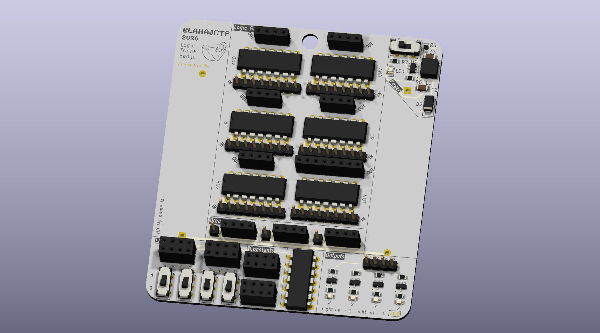
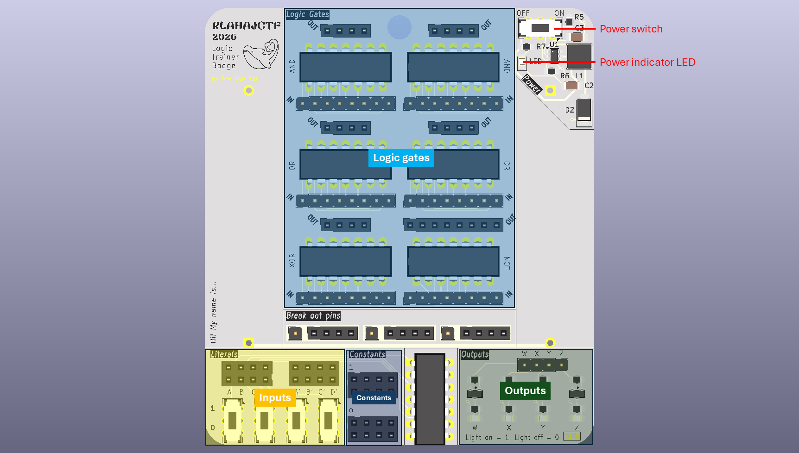
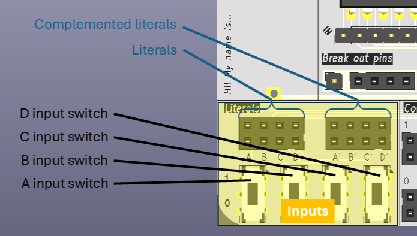
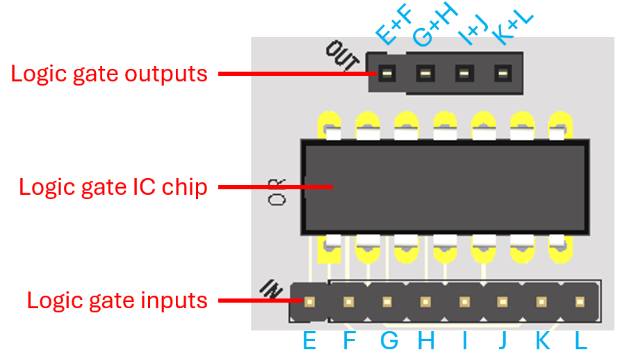
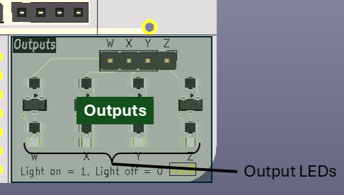
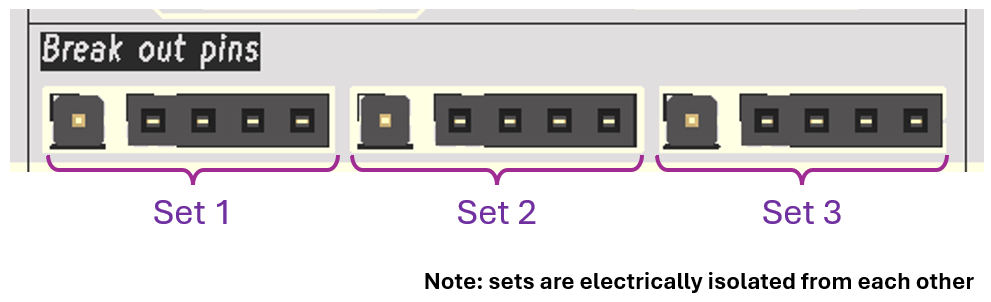

## About the badge
### What is this????

This is a hardware badge, a little wearable circuit board that replaces traditional badges. In addition to identifying you as a finalist in BlahajCTF26, it will also be used for some challenges.

Hardware badges originated from DEF CON, one of the largest hacker conventions in the world. Since then, they have spread to many other cybersecurity conferences and events!

This year's hardware badge is a **logic trainer**, a device designed to teach digital logic by allowing the user to build circuits combining different logic gates.

### Technical specifications
- 8 `AND`, 8 `OR`, 8 `NOT`, 4 `XOR` gates
- 4 input literals (`A`, `B`, `C`, `D`) and their complements (`A'`, `B'`, `C'`, `D'`)
- 4 outputs (`W`, `X`, `Y`, `Z`)
- 3 break out pins
- Constants (`1` and `0`)
- Powered by 2 AA batteries

## The badge

The hardware badge can be divided into 4 main regions that you need to be familiar with in order to use the badge effectively: **inputs**, **constants**, **logic gates** and **outputs**.

### Inputs

Switches allow you to manipulate the values of each of the 4 literals independently. Complemented literals (`NOT` of the literals) are also provided for convenience.

### Constants
Constants supply a fixed `1` or `0` value.

### Logic gates

Operands can be supplied via the input pins and results retrieved via the output sockets. The mapping from input to output is shown in the diagram (`OR` gate IC for example).

### Outputs

`W`, `X`, `Y` and `Z` can be set by connecting to the respective pins. When the LED is lit, it represents the value `1` and when it is unlit, it represents the value `0`.

### Bonus: break out pins

Break out pins are used to "split" a signal, useful for when you want the output of a logic gate to be the inputs to two other logic gates. Each pin and its adjacent set of 4 sockets are electrically connected. There are a total of 3 such sets of pins and sockets.

### Power
> Turn the badge off when not in use to prevent the batteries from draining prematurely! 
{: .prompt-tip }

## Building logic circuits
Logic circuits can be built by making connections between **pins** (metal thing) and **sockets** (plastic hole) using male-to-female jumper wires.

> **Never** connect a _pin to a pin_ or a _socket to a socket_ or you risk a **short circuit**! Sockets are always "output" while pins are always "inputs".
{: .prompt-danger }

> Always power off the circuit before adding/removing connections to prevent accidental shorts and glitchy states.
{: .prompt-warning }

## Appendix: a primer on digital logic
In digital logic, information is represented using discrete binary signals (i.e. 1 or 0, low or high, true or false). Each unit of information is called a 'bit'. Logic gates take in bits and perform logical operations to produce a single output bit. For example, the behaviour of the `AND` gate is shown below, represented as a truth table.

| `A` | `B` | `A AND B` |
|---|---|---------|
| 0 | 0 | 0 |
| 0 | 1 | 0 |
| 1 | 0 | 0 |
| 1 | 1 | 1 |

You may look up the truth tables of the other logic gates online.

### Conventions
The challenge descriptions and docs will use the following conventions:
- `A`, `B`, `C`, `D` to refer to each of the 4 inputs respectively
- `W`, `X`, `Y`, `Z` to refer to each of the 4 outputs respectively
- `.` to represent `AND`. For example `A.B` represents `A AND B`
- `+` to represent `OR`. For example `A+B` represents `A OR B`
- `'` to represent `NOT`. For example `A'` represents `NOT A`
- `^` to represent `XOR`. For example `A^B` is equivalent to `A XOR B`
- The order of operations is `NOT` (highest priority) > `AND` > `XOR` > `OR`
- Similar to arithmetic, brackets can be used to denote order of operations

A logic circuit may be expressed as an equation using the above conventions: `W = (A+B)'+C'.D'`

## Trivia: random facts about this badge
- The badge is a 4 layered PCB
- The badge uses the ICs (integrated circuits) from the 74LS series, a family of low-power Schottky transistor-transistor logic (TTL) ICs
    - _74LS08_ for `AND` gates
    - _74LS32_ for `OR` gates
    - _74LS04_ for `NOT` gates
    - _74LS86_ for `XOR` gates
- There are easter eggs in this hardware badge :D

_happy hacking! ~gr_